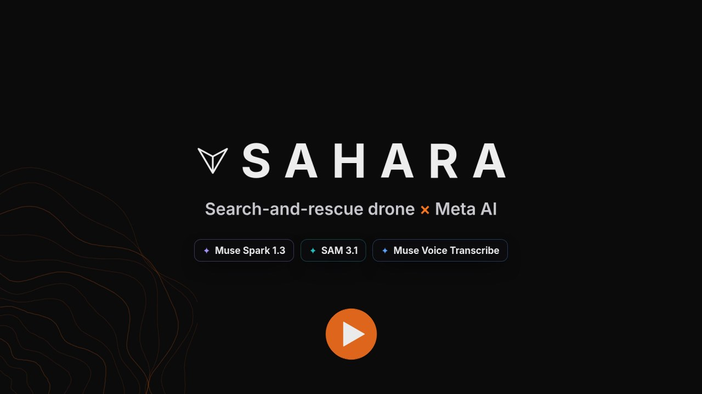

<h1 align="center">SAHARA</h1>

<p align="center">
  <b>An autonomous search-and-rescue drone, with Meta AI as its co-pilot.</b><br>
  It searches a disaster zone, finds casualties and hazards, and briefs rescuers in plain language.
</p>

<p align="center">
  
  
  
</p>
<p align="center">
  
  
  
  
  
</p>

<p align="center">
  <a href="demo/out/sahara-meta.mp4">
    
  </a>
  <br>
  <sub>▶ <b><a href="demo/out/sahara-meta.mp4">Watch the demo</a></b> (2:22): voice commands, hazard detection, aerial triage, AI mission control and the SITREP</sub>
</p>

---

## What it does

An S500 quadcopter (ArduPilot SITL + Gazebo Harmonic, ROS 2 Humble) grid-searches a post-disaster zone. It detects a casualty with an RGB camera by day or a thermal camera at night, verifies the detection, and lands beside them. Everything is driven from a web dashboard.

On top of that autonomy, **SAHARA's Meta AI layer** lets a responder simply *talk* to the drone:

> *"Reports of two people trapped at the collapsed police station. Check it and watch for smoke."*

The AI Mission Commander turns that into actions: it reprioritises the search, flies there, looks with SAM 3.1, marks the hazards it finds, triages the casualty from the air and reports back.

## 🧠 How Meta's AI models are used

| | Meta model | What it does in SAHARA | Code |
|---|---|---|---|
| 🗣️ | **Muse Voice Transcribe 1.0** | Responders speak commands into the dashboard mic; speech is transcribed and handed to the commander. | [`client.py`](sahara_ai/client.py) · [`ai_routes.py`](command_center/backend/ai_routes.py) |
| 🧭 | **Muse Spark 1.3** (agent) | **AI Mission Commander.** Drives the live ROS 2 / Gazebo drone through tool calls: `start_mission`, `prioritize_area`, `inspect`, `report_hazard` and more. It can't arm the drone on its own: the operator must confirm, and every command still goes through the mission bridge's own safety guards. | [`commander.py`](sahara_ai/commander.py) |
| 🔥 | **SAM 3.1** | **Open-vocabulary hazard segmentation.** Segments concepts the detector was never trained on, such as smoke, downed power lines and landslides, straight from the drone camera. The boxes and masks are projected onto the hazard map. | [`perception.py`](sahara_ai/perception.py) · [`sam.py`](sahara_ai/sam.py) |
| 👁️ | **Muse Spark 1.3** (vision) | **Second pair of eyes.** Runs alongside SAM on the same frame and catches what it misses (for example, a downed power line in flat-shaded renders). Where both models agree, the detection is marked as corroborated. | [`perception.py`](sahara_ai/perception.py) |
| 🩺 | **Muse Spark 1.3** (vision) | **Aerial triage.** At each confirmed casualty, the RGB and thermal hover frames go to Muse Spark with a strict JSON schema. It returns pose, visible injury signs, responsiveness cues, nearby dangers, access notes and suggested kit, labelled as a first look rather than a diagnosis. | [`triage.py`](sahara_ai/triage.py) |
| 📋 | **Muse Spark 1.3** | **SITREP narrative.** Writes a short situation report from the mission map, citing only the IDs and numbers in it. | [`triage.py`](sahara_ai/triage.py) |

**Measured on the simulator:**
- Muse Spark tool-call turns take 3–5 s; vision with a JSON schema takes 7–19 s; each call costs about $0.002–0.012.
- SAM 3.1 takes about 3 s per concept and found the smoke plume at 0.84 confidence.
- On the same frame, Muse Spark vision found the downed power line that SAM missed (0.92 / 0.88).

The AI layer ([`sahara_ai/`](sahara_ai)) uses only the Python standard library, so ROS 2 nodes can import it without touching the simulation's pinned environment. It has a daily call cap to protect API credits and a full **mock mode**, so everything runs without an API key. See [sahara_ai/README.md](sahara_ai/README.md).

## 🏗️ Architecture

```
            Responder (voice / chat)
                     │  Muse Voice Transcribe
                     ▼
  ┌──────────── Command Center (Flask + rclpy) ────────────┐
  │  AI Mission Commander ── Muse Spark 1.3 (tool calls)   │
  │  Triage + SITREP ─────── Muse Spark 1.3 (vision)       │
  │  Live map · alerts · rescue priorities · SITREP        │
  └───────────────┬────────────────────────▲───────────────┘
                  │ /resq/ai/command       │ /resq/map
                  ▼                        │
     mavlink_bridge (ROS 2): mission state machine, Bayesian
     search planner, obstacle guard, hazard map, safe routes
        ▲                  ▲                    │ MAVLink
        │ /detections/*    │ /ai/sam/result     ▼
  person_detector    SAM 3.1 + Muse Spark   ArduPilot SITL
  YOLOv8m (RGB)      hazard perception            │
  thermal YOLO            ▲                       │
        ▲                 │                       ▼
        └──── RGB + thermal cameras ──── Gazebo Harmonic (S500 quad,
                                         disaster world, casualties)
```

## 🚀 Run

```bash
./start.sh            # post-disaster world
./start.sh runway     # flat runway world
```

The dashboard opens automatically at http://localhost:5000. Press **Start Search & Rescue**, or open the **AI Commander** panel and tell it what you know. Ctrl+C stops everything. See [command_center/README.md](command_center/README.md) for what each control does, how detection works, and the post-disaster world.

To use the live Meta models instead of mock mode:

```bash
export MODEL_API_KEY=...            # or store it in ~/.config/sahara_ai/key
python3 -m sahara_ai.smoke_test     # checks latency, tool calls, vision and SAM
```

## 📁 Layout

| Path | What's there |
|---|---|
| [`sahara_ai/`](sahara_ai) | Meta AI layer: API client, SAM parser, perception, commander, triage, tests |
| [`command_center/`](command_center) | Web dashboard: Flask backend (+ AI routes) and a plain HTML/JS frontend |
| [`ardu_ws/`](ardu_ws) | ArduPilot + Gazebo workspace |
| ├ `person_detector.py` | RGB (YOLOv8m) and thermal (`thermal_best.pt`, trained on HIT-UAV) person detector |
| ├ `src/ardupilot_gz/` | Launch files and worlds (`runway.sdf`, `disaster.sdf`) |
| ├ `src/ardupilot_gazebo/` | The S500 quad and the world models (collapsed buildings etc. from osrf/gazebo_models) |
| └ `deps.repos` | Pinned upstream repos that aren't committed (ArduPilot, ros_gz, ...) |
| [`ros2_ws/src/`](ros2_ws/src) | `resq_mavlink_bridge` (mission logic) and `resq_mesh_core` |
| [`resq_mavlink/`](resq_mavlink) | `mission.json` (search area), preflight checks and search benchmarks |
| [`worldgen/`](worldgen) | Procedural disaster-region generator |
| [`demo/`](demo) · [`promo/`](promo) | Scripts that edit the demo and promo videos |

## 🛠️ Setting up from a fresh clone

Requires Ubuntu 22.04 with ROS 2 Humble and Gazebo Harmonic.

```bash
cd ardu_ws/src
vcs import --recursive < ../deps.repos
(cd Micro-XRCE-DDS-Gen && git apply ../../patches/Micro-XRCE-DDS-Gen-gradle.patch)
cd .. && colcon build            # ArduPilot SITL, ros_gz, ardupilot_gz, ...
cd ../ros2_ws && colcon build
pip3 install --user -r ../command_center/backend/requirements.txt
```

`command_center/backend/ros_env.sh` sources both workspaces and sets `GZ_SIM_RESOURCE_PATH` for everything the dashboard launches.

### Tests

```bash
PYTEST_DISABLE_PLUGIN_AUTOLOAD=1 python3 -m pytest -q sahara_ai/tests
```
